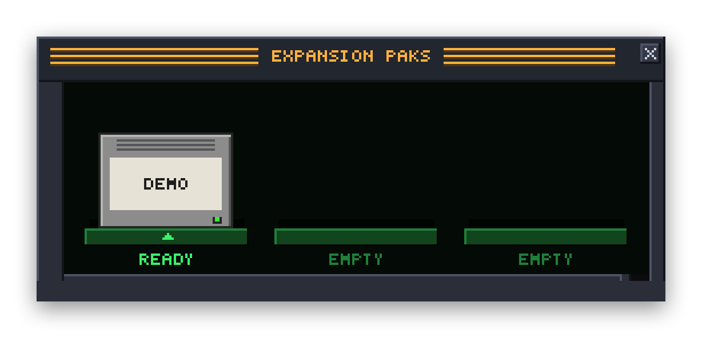

# Writing an Expansion Pak

<p align="center">
  
</p>

An Expansion Pak adds a music source to Bitamp: a server, a radio directory, an archive. Bitamp shows each Pak as a cartridge in its Expansion Paks window (⌥K). Its songs can be searched in the Media Library, added to the playlist and played like local files, with the equalizer, visualizer and Retro Sound all working.

A Pak is a program. Bitamp starts it, asks it questions over standard input and output, and plays the audio it points to. You can write one in Swift with the small SDK in this repository, or in any language that can read and write lines of JSON.

A Pak can also be a **companion** with no music of its own, which writes about the song that's playing in a window of its own, the way Bitamp's Backstory does. See [Notes](#notes).

The demo Pak in `Sources/BitampDemoPak` is a complete example. It plays a few public-domain tunes as chiptunes and needs no server. `Sources/BitampDemoNotesPak` is a companion that writes a few lines about those tunes. Build both with `scripts/make-pak.sh`, then double-click `Demo.bitpak` and `Demo Notes.bitpak` to install them.

## What a Pak is

A folder whose name ends in `.bitpak`:

```
Radio.bitpak/
  pak.json      what the Pak is and which settings it needs
  radio-pak     the program (any name; pak.json says which)
```

`pak.json`:

```json
{
  "id": "radio",
  "name": "Radio",
  "version": "1.0",
  "executable": "radio-pak",
  "protocol": 1,
  "description": "Stations from my radio server.",
  "settings": [
    { "key": "server", "label": "Server", "type": "text" },
    { "key": "password", "label": "Password", "type": "password" },
    { "key": "quality", "label": "Quality", "type": "choice", "options": ["Low", "High"], "default": "High" }
  ]
}
```

- **id** is 1 to 32 lowercase letters, digits and hyphens, starting with a letter. It names the Pak's settings, and its tracks' URLs in playlists (`bitpak-radio://track/<your id>`). Keep it the same between versions.
- **name** is shown on the cartridge and in menus ("Radio Pak").
- **executable** is the program, relative to the folder. It must be inside the folder and executable.
- **protocol** is the version of the messages below that the Pak needs. Use 1, which every Bitamp with Paks understands, unless the Pak writes notes: those need 2 (Bitamp 0.12.0 and later). Bitamp won't install a Pak that needs a newer version than it has, and says it needs a newer Bitamp.
- **capabilities** are optional. `["browse"]` says the Pak can be browsed in the Media Library, with a sidebar, albums, artists, playlists and covers (see [Browsing](#browsing)). Bitamp 0.10 and earlier ignore it and show the Pak's search instead, so one Pak works in both. `["notes"]` makes it a companion that writes notes instead of supplying music (see [Notes](#notes)); it needs `"protocol": 2`, so Bitamp 0.11 and earlier decline to install it rather than showing an empty music cartridge.
- **settings** are optional. Bitamp shows a form for them (right-click the cartridge ▸ Settings…) and passes their values to the Pak. `text` is one line, `password` is kept in the macOS Keychain, `choice` is a pop-up of `options`.

## Messages

Bitamp writes one JSON request per line to the Pak's standard input. The Pak writes one JSON response per line to its standard output, with the same `id`. Anything printed to standard error goes to Bitamp's log (Console.app, process Bitamp). Don't print anything else to standard output.

```
→ {"id":1,"method":"search","params":{"term":"jazz"}}
← {"id":1,"result":{"tracks":[{"id":"42","title":"Take Five","artist":"Dave Brubeck","duration":324}]}}
← {"id":2,"error":{"message":"The server didn't answer."}}
```

An `error` message is shown to the listener, so write it for them.

| Method | Params | Result |
|---|---|---|
| `hello` | `protocol` (the newest Bitamp speaks), `settings` (key → value), `cacheDirectory` | `{"account": Account}` |
| `configure` | `settings` | `{"account": Account}` |
| `search` | `term` (may be empty: list what you'd show first; see below) | `{"tracks": [Track]}` |
| `track` | `id` | `{"track": Track or null}` |
| `resolve` | `id` | `{"source": Source}` |
| `browse` | `location`, `cursor` (optional); only with the `browse` capability | `{"page": Page}` |
| `notes` | `song`; only with the `notes` capability | `update` lines, then `{"text", "sources"}` (both optional) |
| `cancel` | `id` of a request Bitamp no longer wants | none: don't answer it |
| `shutdown` | none | `{}`, then exit |

- **search** with an empty `term` is what the Media Library shows when your Pak opens in it, before the user has typed anything, so it's the first list people see: answer it with something worth playing, such as your newest, most played or favourite tracks. Bitamp sends one search per Return, never one per keystroke.
- **hello** comes first, every time the program starts. `cacheDirectory` is a folder for the Pak's own files; Bitamp creates it.
- **configure** comes when the user saves new settings.
- **Account** is `{"state": "connected" | "disconnected" | "limited", "message": "…"}`. `disconnected` lights the cartridge amber and asks the user to set the Pak up. `limited` means it works with a catch, which `message` explains.
- **Track** is `{"id", "title", "artist", "album", "duration", "artwork"}`. Only `id` and `title` are required. `artwork` is a Cover (see [Browsing](#browsing)). `duration` is in seconds. `id` is yours: Bitamp stores it in playlists and gives it back to `track` and `resolve`, possibly after a relaunch.
- **Source** is where the audio is: `{"file": "/absolute/path.mp3"}` for a file the Pak made or downloaded, or `{"url": "https://…", "headers": {"Authorization": "…"}}` for one Bitamp should download. Bitamp downloads the whole file before playing it and keeps it in the Pak's cache. Any format macOS plays works: MP3, AAC, ALAC, FLAC, WAV, AIFF.

Bitamp starts the program when it's first needed and keeps it running. It sends `shutdown` when it quits or the Pak is removed, and the input closes too; exit when either happens. A Pak that takes more than 30 seconds to answer gets an error. One that crashes is started again, but not after three crashes in a minute.

## Browsing

With `"capabilities": ["browse"]` in `pak.json`, Bitamp 0.11.0 and later browse your Pak in the Media Library the way they browse Apple Music: a sidebar of sections, pages of albums, artists and playlists with covers, and album and playlist pages with a header. Every page comes from one method, `browse`, asked for a **location**:

```
→ {"id":7,"method":"browse","params":{"location":{"kind":"root"}}}
← {"id":7,"result":{"page":{"shelves":[{"title":"Library","items":[
     {"place":{"kind":"section","id":"albums","title":"Albums"}},
     {"place":{"kind":"section","id":"playlists","title":"Playlists"}}]}]}}}

→ {"id":8,"method":"browse","params":{"location":{"kind":"place","id":"albums"}}}
← {"id":8,"result":{"page":{"shelves":[{"items":[
     {"place":{"kind":"album","id":"album:12","title":"Time Out","subtitle":"Dave Brubeck","artwork":{"url":"http://nas.local:4533/cover/12"}}}]}],
   "cursor":"50"}}}

→ {"id":9,"method":"browse","params":{"location":{"kind":"place","id":"albums"},"cursor":"50"}}
```

- **Location** is `{"kind":"root"}` for the sidebar, `{"kind":"place","id":…}` for a place you listed, or `{"kind":"search","term":…}` for the Media Library's search box.
- **Page** is `{"header", "shelves", "cursor"}`, all optional. `shelves` is a list of `{"title", "items"}`; one shelf without a title is a plain list, several make sections like "Albums" and "Top Songs" on an artist's page. `header` is `{"title", "subtitle", "detail", "artwork"}`, shown at the top of an album or playlist ("Dave Brubeck", "Jazz · 1959 · 7 songs").
- **Item** is `{"track": Track}` or `{"place": Place}`.
- **Place** is `{"kind", "id", "title", "subtitle", "artwork"}`. `kind` is `section`, `album`, `artist` or `playlist`; Bitamp shows other kinds as a section. `id` is yours, given back in the place's location. `subtitle` is an album's artist or a playlist's curator.
- **Cover** is shaped like a Source: `{"file": "/absolute/path.png"}` for one you made or downloaded, or `{"url": "https://…", "headers": {…}}` for one Bitamp fetches. Bitamp keeps covers in its own cache, keyed by the file or URL, so give each cover the same address every time, and keep tokens in `headers` rather than the URL.
- **cursor**: when a list goes on, give a `cursor`, and Bitamp asks again with it, at the same location, as the listener scrolls, and when they press PLAY or ADD on a whole album or playlist. The next page's shelves carry on from the last one. Leave it out on the last page.
- The **root** is the sidebar: shelves of `section` places, each shelf's title a heading ("Library", "Radio"). Bitamp asks for it each time the Media Library opens, so it can change. It opens the section the listener had last, or the first.
- An unknown place, or one that's gone, is an `error`, written for the listener ("That album isn't on the server any more.").

Bitamp asks for one page at a time and shows what it has, so answer each quickly; 50 to 100 items a page is plenty. The Demo Pak browses (four sections, one of each kind of place, a cursor and drawn covers): [Sources/BitampDemoPak/Browse.swift](../Sources/BitampDemoPak/Browse.swift).

## Notes

With `"capabilities": ["notes"]` and `"protocol": 2` in `pak.json`, a Pak is a companion: it has no music, and Bitamp 0.12.0 and later give it a window of its own, like Backstory's. The window shows the song that's playing and the Pak's notes about it, with numbered sources, and along the bottom the listener chooses when songs are looked up: AUTO (each song after it has played two seconds), ASK (when they press a button; the first setting, since Bitamp can't know what a lookup costs) or OFF. Bitamp keeps that choice and the notes it's been sent, so a song played again costs nothing. Clicking the cartridge opens the window, and it's in the Window menu. Search, `track`, `resolve` and `browse` are never asked.

Bitamp asks for notes with the song's tags, never its audio or its file's name. A song with no title or artist isn't looked up.

```
→ {"id":7,"method":"notes","params":{"song":{"title":"Take Five","artist":"Dave Brubeck","album":"Time Out"}}}
← {"id":7,"update":{"text":"Paul Desmond wrote it"}}
← {"id":7,"update":{"text":" in 5/4 time."}}
← {"id":7,"update":{"cite":[{"title":"Take Five","url":"https://en.wikipedia.org/wiki/Take_Five"}]}}
← {"id":7,"result":{}}
```

- **update** lines come before the answer, with the same `id`, and the window shows each as it arrives: `{"text": "…"}` adds words, and `{"cite": [Citation]}` marks the words just sent with the sources' numbers ("in 5/4 time. [1]"). Send words as you get them, so the listener isn't left waiting.
- **The answer** ends the notes. `text` and `sources` in it are added after any updates, so a Pak that doesn't stream can send everything there: `{"id":7,"result":{"text":"…","sources":[Citation]}}`.
- **Citation** is `{"title", "url", "quote"}`. `url` must be http or https; others are left out. `quote` is optional.
- **Text** is plain, as Bitamp's pixel font draws it; a blank line starts a paragraph. Markdown isn't drawn.
- **cancel** comes when the song changes before the notes are done. Stop working on them, and don't answer. Anything you still send for that `id` is ignored. The 30-second limit counts from the last line you sent, and is 60 seconds for notes, so a long answer is fine as long as words keep coming.
- **An error** shows in the window, so word it for the listener. A Pak with settings to fill in should answer `hello` with `disconnected`: the window asks the listener to set it up.

## In Swift

Make a Swift package for your Pak that depends on `BitampPakSDK` from this repository. Only the SDK and the message types it uses get built, not Bitamp itself. Keep `pak.json` next to the code and leave it out of the target:

```
Radio/
  Package.swift
  Sources/RadioPak/main.swift
  Sources/RadioPak/pak.json
```

```swift
// swift-tools-version:5.9
import PackageDescription

let package = Package(
    name: "RadioPak",
    platforms: [.macOS(.v13)],
    dependencies: [
        .package(url: "https://github.com/ryanromanov/Bitamp.git", from: "0.5.0"),
    ],
    targets: [
        .executableTarget(
            name: "RadioPak",
            dependencies: [.product(name: "BitampPakSDK", package: "Bitamp")],
            exclude: ["pak.json"]),
    ]
)
```

Then implement four methods and hand the rest to `PakRunner`:

```swift
import BitampPakSDK

final class RadioPak: PakProvider {
    private var server: URL?

    func configure(_ context: PakContext) async throws -> PakAccountState {
        guard let text = context.settings["server"], let url = URL(string: text) else {
            return PakAccountState(.disconnected, message: "Enter your server's address.")
        }
        server = url
        return .connected
    }

    func search(_ term: String) async throws -> [PakTrackInfo] {
        // Ask the server; turn what it says into PakTrackInfo.
    }

    func track(id: String) async throws -> PakTrackInfo? { … }

    func resolve(id: String) async throws -> PakSource {
        guard let server else { throw PakFailure("Set up the Radio Pak first.") }
        return .url(server.appendingPathComponent("stream/\(id)"))
    }
}

PakRunner.run(RadioPak())
```

Throw `PakFailure("…")` for a message the listener should see. `PakRunner.log(_:)` writes to Bitamp's log.

To browse, add the capability to `pak.json` and implement `browse`. Without it, the SDK answers with your search.

```swift
func browse(_ location: PakBrowseLocation, cursor: String?) async throws -> PakBrowsePage {
    switch location {
    case .root:
        return PakBrowsePage(shelves: [PakShelfInfo(title: "Library", items: [
            .place(PakPlaceInfo(kind: "section", id: "albums", title: "Albums")),
        ])])
    case .place("albums"):
        let (albums, next) = try await server.albums(after: cursor)
        return PakBrowsePage(shelves: [PakShelfInfo(items: albums.map { album in
            .place(PakPlaceInfo(kind: "album", id: "album:\(album.id)", title: album.name, subtitle: album.artist,
                                artwork: .url(server.cover(album.id))))
        })], cursor: next)
    case .place(let id):
        // An album: a header, then its tracks.
        …
    case .search(let term):
        return PakBrowsePage(shelves: [PakShelfInfo(items: try await search(term).map(PakItemInfo.track))])
    }
}
```

A companion implements `notes` instead of `search`, `track` and `resolve`, which have empty defaults. Write with `writer` as the words come. When the song changes the task is cancelled, so use awaits that throw on cancellation, such as `URLSession` and `Task.sleep`, or check `Task.isCancelled`. Requests are answered one at a time, as before; a cancel reaches a request that's running.

```swift
final class LinerPak: PakProvider {
    func notes(for song: PakSongInfo, writer: PakNotesWriter) async throws {
        for try await piece in service.write(about: song.title, by: song.artist) {
            writer.write(piece.text)
            writer.cite(piece.sources.map { PakCitation(title: $0.title, url: $0.url) })
        }
    }
}
```

To package it, copy [`scripts/make-pak.sh`](../scripts/make-pak.sh) into your package and run it there. It builds the program in release mode, puts it and `pak.json` in `Radio.bitpak` (named after the manifest's `name`), and ad-hoc signs it, which Apple Silicon requires. Add `--universal` for a program that also runs on Intel Macs. When a package has more than one Pak, it packages each; name a target to package one: `./make-pak.sh RadioPak`.

## In another language

Read lines, answer them. A whole Pak in Python:

```python
#!/usr/bin/env python3
import json, sys

TRACKS = [{"id": "gymnopedie", "title": "Gymnopédie No. 1", "artist": "Erik Satie",
           "url": "https://example.com/music/gymnopedie.mp3"}]

def info(track):
    return {k: track[k] for k in ("id", "title", "artist")}

def answer(method, params):
    if method in ("hello", "configure"):
        return {"account": {"state": "connected"}}
    if method == "search":
        term = params["term"].lower()
        return {"tracks": [info(t) for t in TRACKS if term in t["title"].lower() or term in t["artist"].lower()]}
    if method == "track":
        return {"track": next((info(t) for t in TRACKS if t["id"] == params["id"]), None)}
    if method == "resolve":
        track = next(t for t in TRACKS if t["id"] == params["id"])
        return {"source": {"url": track["url"]}}
    if method == "shutdown":
        return {}
    raise ValueError("Unknown method " + method)

for line in sys.stdin:
    request = json.loads(line)
    try:
        reply = {"id": request["id"], "result": answer(request["method"], request["params"])}
    except Exception as error:
        reply = {"id": request["id"], "error": {"message": str(error)}}
    print(json.dumps(reply), flush=True)
    if request["method"] == "shutdown":
        break
```

Save it as `hello.py` in `Hello.bitpak`, `chmod +x` it, and point `pak.json`'s `executable` at it. Remember `flush=True`, or the equivalent in your language: Bitamp waits for each whole line. There's nothing to build; check it with `--check-pak` (below) and install it.

## Trying it

- Talk to the program by hand first: `printf '%s\n' '{"id":1,"method":"search","params":{"term":""}}' | ./radio-pak`.
- Then let Bitamp 0.6.0 or later check it, without installing it. (An older Bitamp ignores `--check-pak` and just opens; `brew upgrade --cask bitamp` updates it.)

  ```
  $ /Applications/Bitamp.app/Contents/MacOS/Bitamp --check-pak Radio.bitpak --setting server=http://nas.local:4533
  ✓ pak.json: Radio Pak 1.0, id “radio”, runs radio-pak
  ✓ hello: connected
  ✓ search "": 25 tracks, first “Take Five”
  ✓ track “42”: “Take Five”
  ✓ resolve “42”: http://nas.local:4533/stream/42 (not downloaded)
  ✓ shutdown: exited
  The Radio Pak looks good. Double-click it to install it.
  ```

  It reads `pak.json` as installing does, then starts the program and has the same conversation Bitamp has, using the first track it finds. With the `browse` capability, it also opens the sidebar, every section, one album, artist and playlist, and one page after a cursor, and checks that each cover's file is there. A companion with `notes` is asked for notes on Ode to Joy instead, then asked again and cancelled, to check it stops and answers the next request promptly. It catches what usually goes wrong: answers that aren't flushed, other output on standard output, a `track` that forgets an id `search` gave, a file that isn't there, and a program that doesn't exit. Settings take their defaults unless you give `--setting key=value`, once per setting. What the program writes to standard error is shown as it runs. It exits with status 0 when there's nothing to fix.
- Install by double-clicking the `.bitpak`, dropping it on Bitamp, or File ▸ Install Expansion Pak…. Installing a Pak with the same id replaces the old one.
- Installed Paks live in `~/Library/Application Support/Bitamp/Paks`; their caches in `~/Library/Caches/com.ryanromanov.Bitamp/Paks`.
- Click the cartridge to open the Pak in the Media Library, where it shows what `search ""` gives and searches when the user presses Return; a companion's opens its window. Right-click it to browse, change settings, eject or remove it.

## Trust

A Pak runs with the same permissions as the person who installed it, so Bitamp asks before installing one and says so. It removes the download quarantine from a Pak after the user agrees, so macOS doesn't block the program. If you distribute a Pak, sign it (`codesign`), and say where its source is.

## Not yet

- **Streaming.** Bitamp downloads the whole file before it starts playing. Fine for songs on a home server, not for endless radio streams.
- **Paks that play audio themselves**, as a streaming service's own player would, can't be third-party yet; a third-party Pak always hands Bitamp audio to play.
- **Companions beyond notes**, such as lyrics that follow the song or a visualizer. A companion gets the song's tags and writes text.
